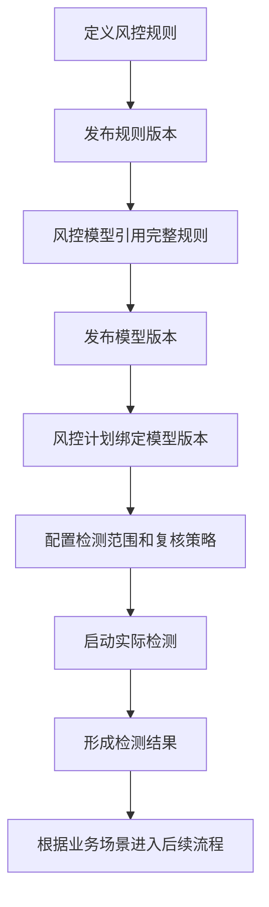
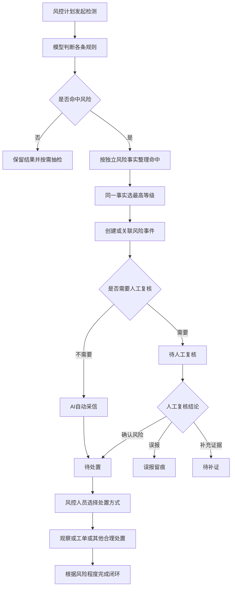

# FDE 合规工作台｜风控规则、风控模型、风控计划业务逻辑说明

> **版本**：V1.1 · 纯业务版  
> **依据**：2026-10-30 最新《合规工作台_风控计划联动定稿版_可交互原型.html》与已确认的业务讨论。  
> **用途**：帮助业务、产品、研发和测试人员理解三类配置的业务职责、使用顺序及检测后的业务流转。  
> **范围**：只说明业务概念、业务配置、判断原则与业务流程；不涉及数据库、接口、技术架构或具体开发实现。  
> **说明**：原型中的案例、置信度和检测结果为演示数据；涉及模型效果的判断不代表实际准确率。

## 一、业务全貌

### 1.1 三类配置分别解决什么问题

**风控规则**回答：**什么情况算风险，属于哪个等级？** 规则定义业务判定标准、排除条件、证据要求及风险等级的高低顺序。规则是可以复用的业务规范。

**风控模型**回答：**利用哪些规则，对什么内容进行识别，输出什么判断？** 模型选择一组完整的已发布规则，结合文字、图片、音频、视频等内容能力，识别可能存在的风险并说明依据。

**风控计划**回答：**对谁、在什么时候检测，检测结果接下来如何流转？** 计划绑定一个已发布的模型版本，明确业务场景、检测范围、执行方式，以及逐规则逐等级的人工复核策略。

三者的业务顺序为：**先有规则，再组装模型，最后通过计划将检测用于实际业务。**

### 1.2 三层业务关系图

> 阅读说明：规则、模型、计划不是相互替代的三种检测方式，而是同一次检测所使用的三层业务配置。

### 1.3 基本业务约束

| 业务事项 | 确定原则 |
|---|---|
| 等级从哪里来 | 只由风控规则定义，模型和计划不得重新发明另一套等级 |
| 检测内容类型由谁确定 | 由风控模型确定，计划不重复配置模型能力 |
| 模型引用什么 | 1 条或多条完整的、已发布的规则版本，不允许只选规则中的个别等级 |
| 计划引用什么 | 一个确定的已发布模型版本 |
| 风险判定与复核如何关联 | 先识别最终风险等级，再匹配该等级在计划中的复核策略 |
| AI 自动采信意味着什么 | 仅意味着本次风险判定不需要前置人工复核，不意味着风险已完成处置 |
| 历史配置是否改变 | 新版本不覆盖旧版本，也不改变历史检测的判断依据 |

---

## 二、风控规则：定义业务风险的判断标准

### 2.1 规则的业务定位

风控规则是平台最基础的业务规范，**一条规则围绕一类清晰的风险问题**展开，并可在多个模型中复用。当前原型预置三类规则，业务人员也可继续创建自定义规则，预置数量不构成上限。

| 规则示例 | 主要判断内容 | 典型业务边界 |
|---|---|---|
| 客户投诉风险判定 | 客户是否表达监管投诉、公司内部投诉、退款诉求或不满 | 判断的是客户表达的风险，不等同于认定销售人员违规 |
| 销售话术合规识别 | 销售人员是否存在不当承诺、夸大宣传、风险揭示不足等问题 | 需要区分说话人及完整语境 |
| 素材合规审核 | 营销素材是否存在不合规表达 | 同一条规则可用于发布前审核，也可识别已发送素材的风险 |

### 2.2 一条规则包含哪些业务内容

1. **基本信息**：规则名称、业务目的和适用场景说明。
2. **评分方式**：默认不评分；确有需要时可选择“按风险等级设置评分区间”。
3. **风险等级**：等级名称、严重程度顺序、各等级判定标准。
4. **辅助判断要求**：排除情形、必要证据、典型示例及等级补充说明。
5. **整条规则的识别说明**：针对全部等级的统一判断要求。
6. **测试和发布**：确认规则内容后发布为可供模型引用的版本。

风控规则**不配置**检测时间、检测人群、人工复核阈值，也不单独决定使用文字、音频或图片进行识别。

### 2.3 风险等级由业务自定义

- 每条规则至少有一个风险等级；等级数量不设固定上限。
- 同一规则内等级名称不能重复；不同规则允许出现相同名称。
- 等级之间存在明确的严重程度优先顺序，按**该规则自身的顺序**判断最高等级。
- `T0、T1、T2、T3、T4` 只是示例，不是所有规则必须采用的统一等级体系。
- 一条规则内，每个等级可以覆盖多种具体命中情形，不必为每一种表达方式重复创建等级。

**举例：**“客户投诉风险判定”可将监管投诉设为 T0、内部投诉设为 T1、退款诉求设为 T2。若同一次独立投诉事实同时符合 T0 与 T1，则以 T0 为最终预警等级，但 T1 的命中原因仍保留。

### 2.4 判定标准、排除条件与证据

判断一个等级是否命中，不只看某个关键词，还需要结合**说话人、上下文、否定或转述关系，以及可以定位的原始证据**。

例如，客户说“我要向监管部门投诉”和销售说“客户没有表示要投诉监管部门”，不能因为都出现“监管投诉”字样而得到相同结论。

规则中的排除条件用于明确**哪些看似相似但不应命中**的情况；证据要求用于说明**什么内容足以支持该等级的判断**。证据不充分时，应保留“不足以判断”的结论，不能为了得到一个等级而强行认定。

### 2.5 评分是可选能力，不等于置信度

规则默认**不评分**。需要量化时，可针对每个等级设置独立且不重叠的分数区间，分数落在所判定等级的区间内。

| 概念 | 业务含义 |
|---|---|
| 风险等级 | 风险严重程度，决定后续采用什么处理策略 |
| 规则评分 | 按规则约定形成的业务分数，可选 |
| AI 置信度 | AI 对某一风险等级判断的可信程度，用于计划的人工复核分流 |

**评分和置信度不得混用。** 本期不引入“按判定项扣分”，也不要求将多条规则的评分合成为一个固定的全局分数。

### 2.6 规则版本如何使用

规则可以保存草稿，也可以发布版本。已发布版本的内容保持不变，供模型明确选择使用。

后续即使修改规则，也应形成新版本；已有模型仍使用原先选择的规则版本。允许从任意历史版本重新开始编辑，并将修改结果发布为一个新的版本，而不是覆盖历史版本。

**业务意义：**任何一次检测，都能解释当时遵循的是哪一版业务判断标准。

---

## 三、风控模型：组织规则并完成风险识别

### 3.1 模型的业务定位

模型将一组已发布的完整规则与识别任务组合起来。一个模型可以同时判断多个风险问题，但各条规则**分别判断、分别保留结果**，不因为放在同一模型中就混成一个风险等级体系。

模型可以用于多个风控计划。例如，同一个“销售会话风险识别模型”既可供实时监测计划使用，也可供每日批量检测计划使用。

### 3.2 模型需要明确的业务内容

| 配置内容 | 业务含义 |
|---|---|
| 模型名称及用途 | 说明模型希望解决什么检测任务 |
| 支持的内容类型 | 明确支持文字、图片、音频、视频等何种输入 |
| 关联规则 | 选择一条或多条完整的已发布规则版本 |
| 模型识别说明 | 补充本次任务的业务背景、判断重点及输入信息要求 |
| 结果表达要求 | 确保每条规则的检测结果包含判定结论、命中等级、理由、证据和置信度等必要信息 |
| 测试与发布 | 用示例内容检查识别行为，再发布为可供计划引用的模型版本 |

规则内已经定义的等级、排除条件、证据要求应完整参与模型识别。**模型不能只挑某条规则中的 T0 或 T1 来检测，遗漏其他等级。**

### 3.3 模型判断的业务顺序

对每条关联规则，模型依次判断：

1. **是否适用**：当前检测对象和语境是否属于本规则关注的范围。
2. **证据是否充分**：是否具备做出可靠判断所需的内容及上下文。
3. **是否命中风险**：是否存在符合规则标准的实际风险事实。
4. **命中哪些等级**：记录全部符合条件的等级及相应证据、置信度。
5. **以哪个等级作为最终等级**：对**同一规则、同一独立风险事实**，取优先级最高的等级。
6. **输出结果**：保留判断理由、原始证据及未被选为最高等级的辅助命中信息。

### 3.4 四种基本检测结果

| 检测结果 | 业务含义 | 后续原则 |
|---|---|---|
| **命中风险** | 已识别到满足规则标准的风险事实 | 根据最高等级匹配风控计划的复核策略 |
| **未命中风险** | 规则适用，但当前未识别到风险 | 默认不创建风险事件，可进入未命中抽检 |
| **不适用** | 规则不适用于当前内容 | 不创建风险事件，也不应当视为“已排除风险” |
| **证据不足** | 缺少必要上下文、内容无法识别或无法可靠判断 | 按计划的证据不足处理方式跟进，不能直接视为无风险 |

### 3.5 模型测试和真实检测的区别

模型配置阶段的测试用于检查识别结果是否符合预期，**不会直接形成正式风险事件、工单或素材发布审批结果**。

只有模型被风控计划实际调用，才依据计划约定的范围、触发方式和复核策略进入业务处理流程。

### 3.6 模型版本

发布模型时，当前选择的规则版本、模型识别说明、支持的内容类型及结果要求应作为一个整体保持稳定。模型发布新版本后，已有计划**不会自动切换**，需要在计划中明确选择并发布新的计划版本后才应用。

---

## 四、风控计划：将检测应用到业务并决定复核分流

### 4.1 风控计划的职责

风控计划不改变规则判定标准，也不重新设计模型。它负责说明：

- **在哪个业务场景运行**：例如销售会话质检、素材发布前审核。
- **检测哪些对象**：哪些客户、组织、会话、素材或业务来源。
- **何时执行**：实时、定时批量或业务触发。
- **采用什么模型**：明确选择已发布模型的具体版本。
- **如何处理风险判断**：按关联规则、按风险等级配置人工复核方式、置信度阈值、时限和通知。
- **如何检查判断质量**：安排 AI 自动采信结果与未命中结果的抽检。

### 4.2 业务场景与执行方式分开理解

| 业务场景 | 关注的问题 | 识别结果流向 |
|---|---|---|
| 销售会话质检 | 销售与客户的沟通，以及已发送素材是否存在风险 | 风险事实进入风险事件、复核与后续处置 |
| 素材发布前审核 | 待发布内容是否符合业务合规要求 | 进入素材审核流程，不默认作为销售风险事件 |

| 执行方式 | 业务含义 |
|---|---|
| 实时监测 | 随新会话或新内容及时发起检测 |
| 定时批量 | 按固定周期检测约定时间范围内的数据，如每日检测前一日内容 |
| 业务触发 | 由素材送检、附件提交等业务动作触发检测 |

**同一个模型可以被不同计划复用**。例如同一模型既用于实时监测，也用于 T-1 每日批量检测；二者可以覆盖同一风险事实，因此需要合并重复发现。

### 4.3 核心：按规则、按等级配置复核方式

一个计划绑定模型版本后，应自动对应模型中每条规则的完整等级。**复核策略的最小配置单位是“一条规则中的一个等级”。**

每个等级可选择：

**方式一：强制人工复核。** 只要该等级成为最终风险等级，无论 AI 置信度高低，都需要风控人员人工确认风险真实性及等级。

**方式二：按置信度阈值复核。** 当该等级成为最终风险等级时：

- AI 置信度**低于**该等级阈值：进入人工复核；
- AI 置信度**达到或高于**阈值，且证据有效、判断正常：允许 AI 自动采信；
- 缺少必要证据、结果异常或无法可靠判断：**不得仅凭高置信度自动采信**，按人工核查或补证方式处理。

不同等级可采取不同复核模式与不同阈值；同一计划中可以混用两种方式。

**配置示例：**

| 规则 | 等级 | 复核方式 | 阈值示例 |
|---|---|---|---|
| 客户投诉风险判定 | T0 | 强制人工复核 | 不适用 |
| 客户投诉风险判定 | T1 | 强制人工复核 | 不适用 |
| 客户投诉风险判定 | T2 | 按阈值复核 | 80% |
| 客户投诉风险判定 | T3 | 按阈值复核 | 85% |
| 客户投诉风险判定 | T4 | 按阈值复核 | 90% |

以上仅为**示例策略，不是平台规定的默认阈值**。上线初期可将所有等级设为强制人工复核；待模型经过真实业务验证，再逐等级开放阈值复核。

### 4.4 多等级同时命中时，阈值怎样生效

**同一条规则、同一个风险事实，多个等级命中时，仅以其中最高优先级等级进行预警和复核分流。**

例如，模型同时命中：T0 置信度 85%，T1 置信度 96%。因为业务优先级为 T0 高于 T1，最终使用**T0 的复核方式及阈值**，不会因 T1 的 96% 更高而降为 T1，更不会分别生成两条 T0、T1 预警。

其他命中等级及证据仍保留，供复核人员了解判断依据。

### 4.5 人工复核的安排

需要人工复核的结果，由计划约定的风控复核团队承接；可采取组内轮流分配、指定复核人员或组内待认领等方式。**复核人员负责判断风险，不等于后续工单整改的主责任人。**

复核时限、紧急通知可根据风险等级区别设置；较严重等级可要求更及时的响应。

需要特别区分：

- **人工复核时限**：从待复核开始，要求多久完成风险判断。
- **风险处置时限**：风险确认或 AI 自动采信后，要求多久选择并推进处置。
- **工单整改时限**：主责任人完成整改并提交结果的要求。

这三个阶段不能简单合成一个倒计时。

### 4.6 证据不足、未命中和不适用

- **证据不足**：按照计划选择的处理方式，转人工核查／补证，或保留检测记录继续跟进；不能当作已经判定无风险。
- **未命中**：默认不生成风险事件，但可以参加抽检，以便发现漏报。
- **不适用**：保留检测结论，不以“无风险”统计替代它。

对于“证据不足但尚未确认存在风险”的对象，不应为了让它进入待办而虚构一个风险等级或已确认风险事实。

### 4.7 抽检与阈值调整

计划应支持两类质量检查：

1. **AI 自动采信结果抽检**：检查是否误报、等级是否判错，以及证据是否足够。
2. **未命中结果抽检**：检查是否存在漏报风险。

抽检发现问题后，保留原始 AI 结论和实际核查结论；发现真实风险时再形成或关联风险事件。抽检结果用于评估不同规则、不同等级的判断效果，并作为是否调整阈值、是否恢复强制人工复核的依据。

**置信度不是经过验证的准确率。** 业务上应依据持续抽检和实际复核反馈，审慎决定何时放开自动采信。

### 4.8 计划版本和启停

计划的模型版本、检测范围、执行时机、复核策略、通知和抽检安排共同构成一版业务配置。

- **保存草稿**：修改尚未发布的计划内容。
- **发布新版本**：使新的计划配置对后续检测生效。
- **查看历史版本**：能够了解过去某个时期采用什么复核方式及阈值。
- **从历史版本重新编辑**：可以基于旧版内容形成新草稿，再发布为新的版本，原历史版本保持不变。
- **启用／停用**：决定是否继续按该计划发起检测，不改变已有检测的历史判断依据。

例如某计划 v1.0 对全部等级实行强制人工，v1.1 只放开 T3 的阈值复核。v1.0 期间发生的检测仍按全人工策略追溯，不因 v1.1 发布而重新判定。

---

## 五、从检测到风险处置的完整业务流程

### 5.1 风险场景的处理流程

> 上图只表达**已经命中的风险**的复核分流；“不适用”“证据不足”分别按第四章的专门原则处理，不能都视为“未命中”。

### 5.2 为什么先识别最高等级，再匹配复核策略

假设“客户投诉风险判定”对同一段投诉事实识别出 T0 和 T1。此时应先确认 T0 的业务优先级最高，再读取计划对 T0 的配置。

如果反过来逐等级分别判断阈值，会出现一条投诉同时生成 T0 与 T1 两项复核任务、重复通知和重复派单的问题。因此**最高等级聚合发生在复核策略生效之前**。

### 5.3 风险事件与预警复核的关系

风险命中后形成**风险事件**；“预警与复核”是需要人工判断的风险事件所组成的业务待办范围，不需要把同一风险再建成一套独立的预警事件。

- **待人工复核**：风险判断尚需由风控人员完成。
- **人工已确认**：风控确认有风险，必要时可修正 AI 预测的等级。
- **AI 自动采信**：符合该等级的自动采信条件，跳过本次人工风险判定。
- **误报**：人工核实没有对应风险，保留原始 AI 判断和改判理由。
- **待补证**：目前不能可靠判定，需补充材料或上下文。

**人工确认和 AI 自动采信是两种不同的风险判定来源。** AI 自动采信不能记录成“人工已经确认”。

### 5.4 AI 自动采信后必须经过“待处置”

本次已明确：**AI 自动采信不自动生成主工单。** 已确认或自动采信的有效风险都进入待处置，由风控人员选择下一步：

| 处置方向 | 业务含义 |
|---|---|
| 风险观察 | 暂时需要持续关注、补充观察或等待后续变化 |
| 创建主工单 | 风险需要明确责任人开展整改与反馈 |
| 有理由地不再进一步处理 | 经风控判断无需继续采取具体措施，须说明原因并遵循对应闭环要求 |

人工复核完成后，并不等于风险已经整改；自动采信后更不能直接视为处置完成。

### 5.5 人工复核与人工闭环是两个不同阶段

| 环节 | 回答的业务问题 | 何时发生 |
|---|---|---|
| **人工复核** | “AI 判断风险是否真实？等级判得对不对？” | 检测后、进入处置前，是否需要由计划逐等级决定 |
| **人工闭环** | “风险已经处理妥当，是否允许结束追踪？” | 风险处置及必要验收完成后 |

**已确认原则：普通风险满足全部处置和验收条件后，可以按既定规则闭环；重大风险必须由有权限的风控人员人工确认闭环。** 即使重大风险在前置阶段被 AI 自动采信，最终闭环仍不能免除人工确认。

复核方式与闭环要求应作为**两个独立的业务控制概念**理解，不应因为已经开启人工复核，就默认每个普通风险还必须再次进行人工闭环审批。

> **需业务进一步明确的边界**：由于规则等级支持自定义，哪些等级属于“重大风险”需要有明确业务认定方式，不应默认只有叫作 T0 的等级才算重大。此项不影响“重大风险必须人工闭环”的已确认原则。

### 5.6 工单与事件的关系

对需要整改的风险，风控人员可以创建一张**主处理工单**。同一风险事件最多关联一张主工单，并指定一名主责任人，必要时可以增加协作者。

- 主责任人可以是涉事销售人员或相应主管，**与人工复核人员不是同一个业务角色概念**。
- 主责任人负责处理、反馈和提交证据；风控人员负责验收。
- 验收未通过时，要求整改并再次提交，历史轮次保留。
- 责任转移需有权限的风控人员批准；批准前原责任人继续承担责任，不因申请转移而自动重置原处理期限。
- 工单验收完成不必然意味着风险事件结束，重大风险仍须人工确认闭环；如有遗留问题可转入观察。

---

## 六、发布前素材审核与销售风险场景的区别

按照已确认的方案 A，发布前素材审核同样可以通过风控计划发起检测，但**业务流转不同**。

| 场景 | 使用规则的方式 | 检测之后 |
|---|---|---|
| 发布前营销素材审核 | 使用已发布素材合规规则判断待发布内容 | 进入素材审核流程，由素材审核人员按业务权限处理 |
| 销售已经向客户发送素材 | 使用同一素材规则判断已发送内容的风险 | 若确认是销售会话中的风险事实，可进入风险事件与处置流程 |

因此，**AI 自动采信素材违规结论不等于自动批准素材发布**；对素材是否退回、修改或允许发布，仍需遵循素材审核业务要求。

这也意味着“风控计划统一组织检测”不等于“所有检测结果都必须进入同一种风险事件或主工单”。

---

## 七、重复检测、多风险事实与风险升级

### 7.1 一条风险事实只形成一条风险事件

以下情况**不应仅因为检测次数或命中等级数量增加而重复创建事件**：

- 同一事实既命中 T0 又命中 T1；
- 同一事实先被实时计划发现，后又被每日批量计划发现；
- 同一事实在补充证据后再次检测；
- 同一事实置信度变化，但风险本身没有变成另一件独立事件。

新发现的命中、证据和检测结果应追加到原风险事件的历史中。

### 7.2 同一会话也可能包含多个独立事实

“只取最高等级”**不是**“一段会话只能有一条风险事件”。如果一段会话中出现两个彼此独立的风险事实，即使涉及同一条规则，也可以分别形成事件。

判断重点是**业务事实是否独立**，而不是风险标签是否相同、是否来自同一段文本。

### 7.3 风险等级变化时如何处理

- **发现更高等级**：保留既有结论，补充新的识别依据，并触发风险升级核查与必要通知。
- **再次只发现较低等级**：不得自行把原来已经人工确认的严重风险降级。
- **人工改判等级**：保留 AI 原始等级、人工确认等级及原因；后续处置以业务上最终确认的等级为依据。

升级和改判强调**保留过程、明确责任**，而不是覆盖过去曾经发生过的判断。

---

## 八、版本变更如何影响实际业务

### 8.1 三种版本分别管什么

| 版本 | 固定的业务内容 | 何时需要新版本 |
|---|---|---|
| 规则版本 | 风险等级、严重程度顺序、判定标准、排除条件、证据要求、可选评分与识别说明 | 业务判定标准发生变化时 |
| 模型版本 | 关联的完整规则版本、模型识别说明、输入内容能力与结果要求 | 检测任务配置或引用的规则版本发生变化时 |
| 计划版本 | 绑定的模型版本、业务检测范围、执行安排、各等级复核方式与阈值、相关复核和抽检策略 | 执行或复核业务策略发生变化时 |

### 8.2 版本变化的业务示例

某计划最初采用 **v1.0 全等级强制人工复核**。经过人工复核和抽检发现 T3 判断相对稳定，业务人员修改 T3 为“达到 90% 可自动采信”，并发布 **v1.1**。

- v1.1 生效之后的新检测，可以按新的 T3 阈值分流。
- 过去采用 v1.0 的检测，仍应说明当时是全人工复核，不能回过头重新算成自动采信。
- 如果规则后来增加了新等级，应先让模型引用新规则版本，再在新计划配置中明确该等级的复核方式，不能不经确认自动继承其他等级阈值。

**版本管理的业务目的，是能够解释“当时为什么这样判断、为什么要求人工或允许自动采信”，而不是单纯保留一个版本数字。**

---

## 九、完整业务示例

### 示例 A：多等级命中并强制人工复核

客户表示：“再不给我答复，我要投诉到公司总部，也要向监管部门投诉。”

1. 客户投诉规则同时识别内部投诉和监管投诉。
2. 监管投诉对应等级在该规则内优先级更高，因此成为最终预警等级。
3. 该计划对此等级配置强制人工复核，进入待复核。
4. 风控人员确认风险真实性，必要时修正等级。
5. 风险进入待处置，由风控决定观察或创建主工单。
6. 如该等级被认定为重大风险，处理完成后仍需授权人员人工确认闭环。

**业务结果：一个风险事实、一条风险事件、最高等级优先，其他命中保留。**

### 示例 B：阈值模式自动采信，但不自动派工单

某规则的 T3 等级配置“按阈值复核，阈值 90%”。本次 AI 对该独立风险事实的 T3 判断置信度为 95%，证据有效。

1. 最终等级为 T3。
2. 95% 达到该等级的 90% 阈值，允许 AI 自动采信。
3. 风险事件记录为 AI 自动采信，并进入**待处置**。
4. 风控人员再选择观察、主工单或其他合理处置；模型不会直接替人做出工单决策。
5. 该自动采信结果仍可能被抽检，后续发现错误可按人工核查结果纠正并保留原结论。

**业务结果：减少前置人工复核，不减少后续风险处置责任。**

### 示例 C：未命中被抽检发现漏报

模型认为当前会话未命中某条风险规则。

1. 原检测结果保存为“未命中”，不立即生成风险事件。
2. 该结果被选入未命中抽检。
3. 风控人员发现确实存在应识别的风险事实。
4. 根据核查结果创建或关联相应风险事件，明确实际等级并进入后续业务流程。
5. 此次抽检结论用于评估模型效果和后续调整复核策略。

**业务结果：未命中不等于永远无风险；抽检是发现漏报的必要补充。**

---

## 十、业务理解的最终统一口径

| 常见误解 | 正确认识 |
|---|---|
| “规则、模型、计划都是检测配置，可以互相替代。” | 规则定义标准，模型组织识别，计划管理业务运行和复核分流 |
| “一条规则命中两个等级，就要创建两条预警。” | 同一独立风险事实只取最高等级形成一条事件，其他等级留痕 |
| “置信度高就代表风险等级高。” | 等级表示严重程度，置信度表示判断可信程度，二者独立 |
| “开启人工复核后，还设置人工闭环是重复。” | 前者确认风险是否真实，后者确认风险是否处理完毕；普通与重大风险闭环要求不同 |
| “AI 自动采信意味着已经处理完成。” | 自动采信只是免去前置人工判定，仍进入待处置 |
| “模型发布新版本，所有计划自动升级。” | 计划明确绑定模型版本，需要发布新计划版本才更新 |
| “实时发现过，第二天批量检测需要再建事件。” | 相同风险事实归并，重复检测保留新的证据和历史 |
| “发布前素材发现风险，自动创建销售整改工单。” | 发布前素材走素材审核业务流程，已发送素材风险才可能进入事件处置 |

**最终业务主线：规则定义风险 → 模型识别风险 → 计划决定检测与复核 → 事件记录事实 → 风控决定处置 → 整改验收及分级闭环 → 抽检结果反哺后续计划调整。**

---

**文档边界说明**：本说明为业务理解稿，未讨论数据库、接口、技术方案、开发任务或验收用例。文中明确标注的“重大等级如何认定”属于尚需进一步明确的业务口径；其余内容以最新原型和此前已确认的业务原则为依据。
