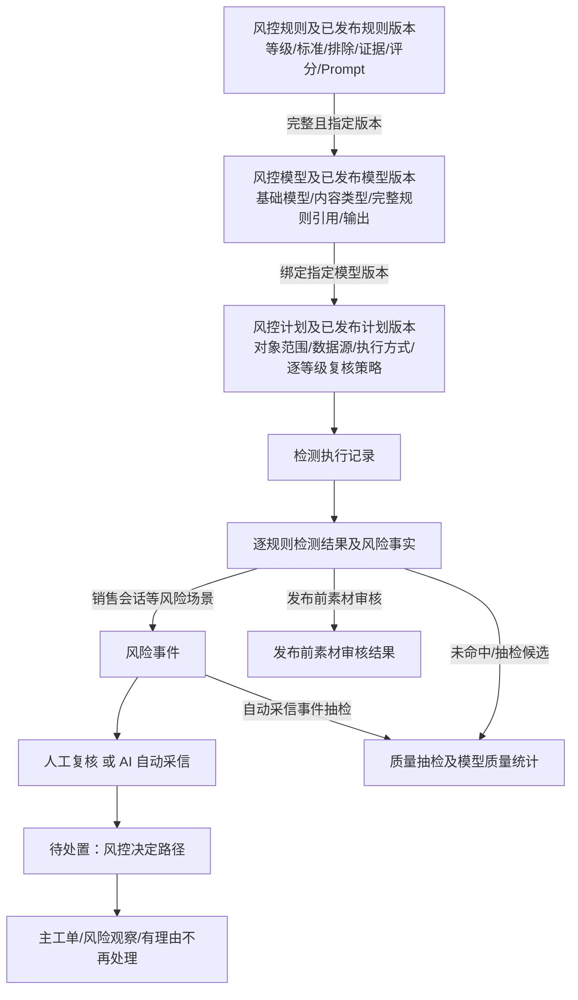
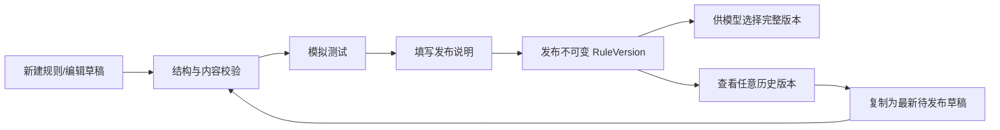
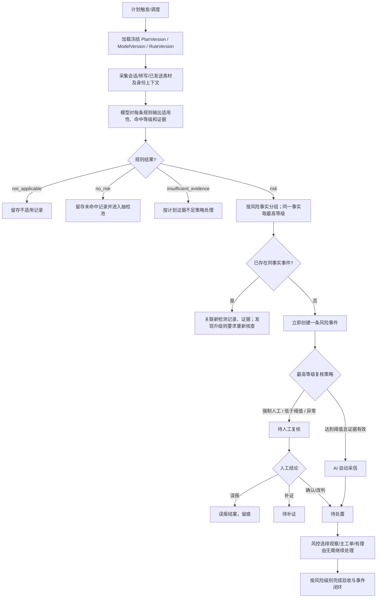

# FDE 合规工作台：风控规则、风控模型、风控计划业务逻辑说明

> **文档版本**：V1.0（研发理解稿）  
> **整理日期**：2026-10-30  
> **依据**：用户提供的《合规工作台_风控计划联动定稿版_可交互原型.html》及已确认的业务讨论。  
> **范围**：风控规则、风控模型、风控计划，以及它们与检测执行、预警复核、风险事件、处置工单、素材审核、模型质量的关键联动。  
> **文档性质**：业务说明和研发设计输入，**不是原型代码逐行实现规范，也不等同于已经联通生产系统**。

## 0. 阅读约定与核心结论

为避免研发把离线演示效果误认为正式实现，本文件采用以下标识：

- **【已确认业务】**：前期讨论已经确定，应作为目标业务逻辑。
- **【原型现状】**：所上传 HTML 中可查看的界面或实际脚本行为。
- **【研发补充建议】**：为保证可实现性、可审计性而补充的技术/业务落地建议，需由产品和研发评审。
- **【需修正】**：原型表现与已确认业务不完全一致，研发不应直接照抄。

**最核心的一句话：规则决定“什么算风险”，模型决定“怎么识别并输出”，计划决定“对谁、何时检测，以及识别后是否需人工确认”；风险事件负责留痕，风控人员负责选择处置，工单负责整改。**

以下五条是全链路不变量：

1. 一个模型引用 **1～N 条已发布业务规则的完整、指定版本**，不能只勾选规则内部分等级。
2. 同一**规则 + 同一风险事实**命中多个等级时，最终只以**优先级最高等级**触发一条预警/风险事件；其他命中等级和证据仍保留。同一规则中不同独立事实，可以产生不同事件。
3. 风控计划在**规则、等级**维度选择「强制人工复核」或「按置信度阈值复核」。符合阈值且证据有效，才可以 AI 自动采信。
4. **AI 自动采信只跳过风险判断阶段的人工复核**；事件仍进入**待处置**，不会自动派发主工单，也不意味着风险闭环。
5. 规则、模型、计划已发布版本及执行时采用的配置**可追溯、不可被后续编辑覆盖**。重大风险无论前置是否人工复核，最终均须授权人员人工确认闭环。

---

## 1. 总体架构、术语与职责边界

### 1.1 三层配置与一条运行链路



### 1.2 对象定义与边界

| 对象 | 定义 | 负责 | 不负责 |
|---|---|---|---|
| 风控规则 `Rule` | 可复用的业务判定规范 | 规则名称、风险等级与优先级、判定标准、排除条件、证据要求、可选评分和 Prompt | 内容模态、数据来源、检测时间、人工复核阈值 |
| 规则版本 `RuleVersion` | 某次发布后的完整规则快照 | 固定当期判定依据，供模型引用 | 随最新规则自动更新 |
| 风控模型 `Model` | 组织一组规则与模型识别能力的检测配置 | 基础模型、内容类型、输入模板、任务 Prompt、规则版本引用、标准 JSON 输出 | 检测调度、复核分派、最终处置 |
| 模型版本 `ModelVersion` | 某次发布后的模型配置快照 | 固定规则引用、模型参数和输出规范 | 自动替换被计划引用的旧版 |
| 风控计划 `Plan` | 使用确定模型版本执行某个业务检测任务的配置 | 检测对象/来源/频率、按等级复核策略、时限通知、复核分派及抽检策略 | 改写风险等级标准、替代人工处置决策 |
| 计划版本 `PlanVersion` | 当期实际生效的计划配置 | 固定执行和人工复核策略 | 反向改写已结束执行记录 |
| 检测执行 `Execution` | 计划对一批/一个检测对象的一次运行 | 保存输入对象标识、使用版本、逐规则结果、执行状态 | 直接代表一个风险事件 |
| 风险事实 `RiskFact` | 证据指向的一个独立风险事实 | 去重、聚合多等级命中、定位证据 | 与等级命中条数一一对应 |
| 风险事件 `RiskEvent` | 对单个风险事实的全生命周期记录 | AI 原始判定、人工/自动采信、处置、闭环和审计 | 与处理工单混为同一对象 |
| 主处理工单 `Ticket` | 对确认/采信后需整改的风险开展处理 | 唯一主责任人、期限、整改证明、验收 | 一次 AI 命中即自动创建 |
| 质量抽检 `QualitySample` | 对自动采信和未命中结果进行核查 | 判断误报、错级、漏报并反哺质量 | 将全部未命中样本直接建成事件 |

### 1.3 重要关系

- `Rule 1 : N RuleVersion`；`ModelVersion N : M RuleVersion`（通过**带版本号的引用**实现）。
- `Model 1 : N ModelVersion`；`PlanVersion N : 1 ModelVersion`。
- `Plan 1 : N PlanVersion`；`PlanVersion 1 : N Execution`。
- `Execution 1 : N RuleResult`；一条规则结果可能有多个命中等级、多条证据，生产设计应支持多个独立 `RiskFact`。
- 同一 `RiskFact` 在不同 `Execution` 重复识别时，关联到同一 `RiskEvent`；`RiskEvent 0..1 : 1 主 Ticket`。
- 发布前素材审核结果可关联 `Execution` 和 `MaterialReview`，**不默认**建立销售风险事件。

---

## 2. 风控规则：定义可被复用的风险判定标准

### 2.1 预置规则及扩展

【原型现状】预置三条规则，用户可以另外新建自定义规则；三条**不是系统允许规则数量的上限**。

| 预置规则 | 主要判断对象 | 示例等级/风险 | 使用注意点 |
|---|---|---|---|
| 客户投诉风险判定 `R-COMPLAINT` | **客户**表达及相关上下文 | T0 外部/监管投诉、T1 内部投诉、T2 退款退费、T3 服务不满 | 区分客户本人诉求、转述、咨询、否定表述；不直接判定销售人员违规 |
| 销售话术合规识别 `R-SALES` | **销售人员**的实际发言 | 收益承诺、不当投资建议、夸大宣传、风险揭示不足等 | 需判断说话人、语境、授权范围和完整沟通历史 |
| 素材合规审核 `R-MATERIAL` | 待发布素材或销售已发送素材 | 违规收益宣传、资质业绩不实、夸大宣传、风险揭示不足等 | 同一规则复用，但**发布前审核**与**已发送素材风险处置**是不同业务流转 |

注意：上表中 T0/T1/T2/T3 是**预置规则示例名称**，自定义规则可使用高/中/低、P0/P1 或其他名称。业务执行不得把某个字符串硬编码成“最高等级”。

### 2.2 规则配置结构

【原型现状】页面采用**规则列表 → 二级详情 → 详情内编辑**，不是逐层子页面向导。编辑顺序如下：

1. **基本信息**：名称、说明；系统内部稳定规则 ID。
2. **评分方式前置**：默认不评分；可开启“等级区间评分”。
3. **风险等级配置**：等级名称、优先级顺序、判定标准、排除条件、必要证据、可选典型样例及等级补充 Prompt；启用评分时增加该等级分数区间。
4. **规则总 Prompt**：适用于整条规则所有等级。
5. **测试与发布**：模拟结构测试、版本说明、保存草稿、发布新版本。

**规则没有“检测内容类型/文字图片音频视频”配置**；内容类型只在模型层声明。

#### 等级及校验

- 同一规则内等级名称必须唯一，且不能为空。不同规则可以有同名等级。
- `conditions[]` 在该原型中实际上是**等级列表**；从前到后即从严重到轻微。研发可以命名为 `grades[]`，避免继续误解为独立子规则。
- 一个等级可以包含多种命中情形，标准、排除、证据可以写成多段；无需为每种情形创造重复等级。
- 至少有一个等级；判定标准、规则名称、说明、总 Prompt 为发布必填。
- 排除条件、必要证据、示例和等级补充 Prompt 在界面中作为辅助字段；为提高质量，建议研发对高风险规则增加配置质量检查，但不要擅自提升为所有场景的强制项。
- **【研发补充建议】** 每个等级保存稳定的内部 `grade_id` 和 `priority`，展示名称 `level` 可调整；模型结果、历史快照、计划策略引用应优先用稳定 ID，而不是只用可改名的等级字符串。

#### 可选的等级区间评分

- 只有两种配置：`不评分`、`启用等级区间评分`；**本期不再采用“按判定项扣分”**。
- 开启后，每个等级必须配置 `0～100` 范围内的闭区间，例如 T0=`0—19`、T1=`20—39`；区间**不得重叠**。
- 模型应先判定命中等级，再在该等级区间内给出业务评分。评分不是“置信度”，也不作为跨规则统一总分。
- 关闭评分时规则结果 `score` 为 `null`，不应填写一个虚构的分数。
- 【研发补充建议】评分方向（低分更严重/高分更严重）要明确保存；跨等级分段是否要求连续覆盖 0～100 当前未约定，不能自行强制。

### 2.3 等级命中与最高优先级

【已确认业务】对于同一规则、同一风险事实：

1. 模型可以识别多个适用的等级，并保留每个命中等级的证据。
2. 依据**已发布规则版本的等级排列优先级**选择最高等级，不是按名称字典序，也不是选置信度最高的等级。
3. **只生成该事实的一条预警/风险事件**，以最高等级关联后续计划策略。
4. 未被选为最高等级的命中信息仍在原始检测记录、事件明细中留痕。

例如：同一条客户投诉事实同时命中 T0（置信度 85%）与 T1（置信度 96%），最终是 T0，使用 T0 的阈值、通知和复核时限；不能因为 T1 的置信度更高而自动降级。

### 2.4 规则版本生命周期



- **保存草稿**与**发布版本**是不同操作。
- 原型规则发布要求：等级唯一、判定标准及必要基本信息完整；开启评分则区间合法且互不重叠；填写发布说明；完成一次演示结构测试。
- 允许从任意历史版本复制完整配置，生成**新的最新版本草稿**；例如最新为 v1.3，从 v1.0 派生并发布时是新的 v1.4，而非改写 v1.0。
- 如果已有草稿，派生历史版本前应提醒用户覆盖风险。
- 既有模型始终使用原来锁定的版本，不会因为规则发布新版而升级。
- 【原型现状】历史版本和部分旧版规则结构可同时存在；研发需为历史数据兼容，而不是批量覆写历史等级结构。

---

## 3. 风控模型：将完整规则版本转换为可执行的识别任务

### 3.1 模型配置页面与步骤

【原型现状】当前上传原型中的模型编辑器**实际为六步**，如下表（不是旧讨论稿中的七步）：

| 步骤 | 配置内容 | 关键约束 |
|---|---|---|
| 1. 基本信息 | 模型名称、内部编号、基础模型服务、业务场景、模型版本、支持的内容类型 | 至少选一种内容类型；文字、图片、音频、视频、文档在此声明 |
| 2. 关联业务规则 | 从规则目录选择 1～N 条**已发布完整版本**，可选各条的历史已发布版本 | 不允许选单个等级，不设条件权重或跨规则 100 分总分 |
| 3. Prompt 配置 | 平台不可变约束、系统基础 Prompt、可填写任务补充指令；高级模式编辑任务 Prompt；输入模板 | 规则总 Prompt、各等级补充 Prompt 随引用自动注入 |
| 4. JSON 输出 | 标准系统字段、逐规则结果、可选扩展字段、Schema 编辑校验 | 不允许删除关键字段；JSON 只表述检测结果，不能直接决定工单或发布审批 |
| 5. 测试调试 | 输入演示样本、切换模态、查看模型结构化结果 | 原型仅本地关键词匹配；**模型测试不触发业务风险事件** |
| 6. 版本发布 | 校验完整配置、填写发布说明、发布模型版本 | 锁定规则引用、Prompt、内容能力和输出结构；计划不自动升级 |

原型展示的基础模型名称/供应商标识仅为演示选项，不构成生产环境必须使用特定供应商的约束。

### 3.2 Prompt 的内部组装顺序

【原型现状】组合执行指令大致由以下内容构成：

```text
平台级不可修改约束
  + 模型任务指令（默认基础 Prompt + 业务补充；或授权的高级任务 Prompt）
  + 每条关联业务规则的已发布版本
      - 规则总 Prompt
      - 全部等级的标准、排除条件、证据要求、可选补充 Prompt
  + 模型输入模板（会话、素材、员工及客户信息变量）
  + 本次实际输入数据与可定位证据
```

业务关键点：

- 风险判断前必须区分**客户发言、销售发言、素材内容**，防止把客户投诉误判成销售违规。
- 传入文本、附件及素材中的内容属于**待检测数据**，不能被当作控制系统行为的指令。
- 对每条规则分别判断适用性和风险；不把不同规则的等级和分数混合。
- 结构化标准及系统安全约束优先；可选 Prompt 不能突破冻结规则版本。
- 【研发补充建议】把组合 Prompt、来源版本和哈希记录在运行快照中，方便重放审计，但注意脱敏与数据访问控制。

### 3.3 单次检测的规则级结果

原型支持四种 `status`：

| 状态 | 意义 | 后续处理 |
|---|---|---|
| `risk` | 当前规则识别到风险命中 | 按最高等级和计划复核策略处理 |
| `no_risk` | 当前规则适用，但未识别出命中风险 | 不产生风险事件；可进入未命中抽检 |
| `not_applicable` | 当前检测对象不适用于该规则 | 不产生风险事件；不应统计为无风险通过 |
| `insufficient_evidence` | 内容不可解析、缺关键证据等，无法可靠判断 | 依据计划的证据不足策略进行人工核查或保留待跟进记录；不得当作无风险 |

每条规则至少应返回：

- `rule_id`、`rule_version`、`status`；
- `matched_conditions`（原型字段名，业务含义为全部命中等级）；
- `matched_level_details[]`：每个命中等级的置信度及证据引用；
- `highest_level` / `primary_level`：最高风险等级；
- `confidence` / `primary_confidence`：对应最高等级的置信度；
- `score`：规则启用区间评分时才有；
- `findings[]`：风险原因、证据原文、引用定位；
- `risk_facts[]`：为独立事实去重提供线索。

**数值单位**：原型 JSON 里置信度是 `0～1` 的小数（如 `0.85`），计划页面阈值是 `0～100` 的百分数（如 `85`）。研发须在策略判断前统一尺度；不要把 `0.85 < 85` 直接比较。

### 3.4 推荐的输出示例（用于接口理解）

> 以下为按已确认逻辑整理的**推荐契约示例**，不是 HTML 原型现有 JSON 的逐字复制；示例值均为模拟数据。

```json
{
  "execution_id": "EX-20261030-0001",
  "target_id": "CHAT-001",
  "model_id": "M-CHAT",
  "model_version": "v1.0",
  "rule_results": [
    {
      "rule_id": "R-COMPLAINT",
      "rule_version": "v2.1",
      "status": "risk",
      "matched_conditions": ["T0", "T1"],
      "matched_level_details": [
        {"level": "T0", "confidence": 0.85, "evidence_refs": ["MSG-001"]},
        {"level": "T1", "confidence": 0.96, "evidence_refs": ["MSG-001"]}
      ],
      "highest_level": "T0",
      "primary_level": "T0",
      "primary_confidence": 0.85,
      "score": 12,
      "findings": [
        {"level": "T0", "evidence_refs": ["MSG-001"], "evidence_excerpt": "我要向监管部门投诉"}
      ],
      "risk_facts": [
        {"fact_id": "FACT-001", "highest_level": "T0", "evidence_refs": ["MSG-001"]}
      ]
    }
  ]
}
```

**【研发补充建议】** 真正生产接口应明确是否允许一个 `rule_result` 返回多个 `risk_facts`。当前原型的离线检测器基本将一条规则一次运行归并成一个演示事实，尚不能可靠识别同规则下两个独立违规事实；产品目标则要求支持它们分别建事件。

### 3.5 模型测试和计划执行严格区分

- **模型测试**：检查输入、角色识别、规则输出、等级、结构化格式，**不生成风险事件、工单或素材审核审批结果**。
- **计划执行**：引用一个已发布模型版本，才应用数据范围、执行周期、各等级复核策略、事件去重和抽检策略。
- 模型升级后，已有计划不会自动切换，须由计划配置人员确认后发布新的计划版本。

---

## 4. 风控计划：调度检测并决定复核分流

### 4.1 页面结构与配置职责

【原型现状】采用**计划列表 → 二级详情 → 详情内编辑**，详情区分四个配置区：

1. **基本信息与执行策略**：计划名称、绑定模型版本、执行方式、执行节奏、业务对象范围、数据来源、组织范围。
2. **按规则、按等级设置复核策略**：逐条关联规则、逐个等级设置复核方式、置信度阈值、人工复核时限、通知渠道；支持批量切换模式。
3. **复核与处置**：复核团队、组内分派方式、证据不足处理方式。
4. **发布与执行**：保存草稿、发布新计划版本、历史版本、模拟执行、执行记录。

具体检测内容模态不在计划重复配置，而是由**绑定模型版本**定义。

### 4.2 业务场景和执行方式是不同维度

| 维度 | 可选值 | 业务含义 |
|---|---|---|
| 业务场景 | 销售会话质检 | 销售/客户会话及已发送素材的合规风险检测，风险命中可能生成风险事件 |
| 业务场景 | 素材发布前审核 | 素材提交到发布流程前的审核，结果进入素材审核链路，不默认创建销售风险事件 |
| 执行方式 | 实时监测 | 按增量或准实时触发，维护必要上下文窗口 |
| 执行方式 | 定时批量 | 约定执行时间、数据时间窗口（如每日前一天数据） |
| 执行方式 | 业务触发 | 收到素材送检等业务事件即发起执行 |

【原型现状】业务场景字段已经存在，但界面中主要根据绑定模型自动推断并展示；**【研发补充建议】** 正式实施时应将“业务场景”作为明确可确认的计划字段，并校验模型能力与该场景是否兼容，不能只用模型名称中含“素材”等文本进行推断。

**执行来源示例**：企微会话存档、通话转写、直播评论、素材系统；再通过客户范围、组织范围限定实际检测对象。实时执行需要幂等和上下文去重；批量执行需要时间窗口和断点续跑；业务触发需要上游送检 ID。

### 4.3 逐规则、逐等级复核策略

【已确认业务】计划绑定模型的具体版本后，自动读取该模型引用的每条规则版本及其完整等级列表。**计划只配置这些等级的执行策略，不重新定义等级或风险标准。**

一项等级策略概念上包含：

| 字段 | 类型 | 用途 |
|---|---|---|
| `rule_id`、`rule_version` | 关联 | 精确定位模型引用的规则版本 |
| `grade_id` / `level` | 关联 | 精确定位规则中的等级 |
| `review_mode` | 枚举 | `manual`（强制人工）或 `threshold`（阈值复核） |
| `threshold` | 0～100，条件必填 | 仅阈值模式使用，判断是否需要人工确认 |
| `review_sla_minutes` | 正整数 | 需要人工复核时的确认时限 |
| `notification` | 渠道/策略 | 该等级的提醒渠道与紧急程度 |

**原型内部策略键**为 `ruleId::level`；【研发补充建议】生产环境优先采用 `rule_version_id + grade_id`，避免等级改名、版本演进时引用错配。

#### 分流判定表

| 情形 | 结果 | 说明 |
|---|---|---|
| 最高等级配置强制人工 | 待人工复核 | 无论模型置信度高低 |
| 最高等级配置阈值模式，置信度**低于**阈值 | 待人工复核 | 例如 T0：45% ＜ 50% |
| 阈值模式，置信度**达到或超过**阈值，且证据有效、输出正常 | **AI 自动采信** | 例如 T0：85% ≥ 50% |
| 缺失必要证据、识别/结构解析异常、等级无对应策略 | 不能自动采信 | 应降级为人工或待补证/异常队列，保留检测记录 |
| 同一事实命中 T0、T1 | **只按 T0 策略分流** | T1 不再触发第二条事件或独立复核策略 |

**阈值不代表风险严重程度**。T0 可以设置低阈值，T4 可以设置高阈值，这与等级优先级不冲突；严重程度决定最终选用哪个等级策略，置信度再决定该策略是否转人工。

**阈值也不是规则区间评分**。前者是模型判断可信程度，后者是规则定义的业务分数，两者不得互换。

### 4.4 复核人员和时限

【原型现状】支持复核团队，组内分派方式：

- **轮询分派**：在指定复核组内轮流指定复核人；
- **指定固定复核员**：统一指向配置人员；
- **组内待认领**：进入组待办，不预先指定个人。

以上只控制**风险判定阶段**的人工复核责任。风控人员后续选择主工单时，才指定涉事销售或销售主管作为**工单主责任人**，两者不可混用。

- `review_sla_minutes` 从需要人工复核的时点起计算；自动采信不产生“人工复核待办”，不应人为统计为复核超时。
- **风险处置时限 / 工单期限**与前置复核时限是不同指标。自动采信后仍需及时作出处置决定。
- 【研发补充建议】计时起点、暂停/恢复、非工作时间规则、超时升级和通知去重应在正式 SLA 规范中统一。

### 4.5 证据不足与未命中处理

【原型界面】计划允许为证据不足选择「转人工复核」或「仅保留检测记录」。应按业务含义区分：

- `no_risk`：适用但未命中；默认只保存执行结果，并按计划的未命中抽检策略抽样，不直接建事件。
- `not_applicable`：不适用；保存执行事实，不能计入无风险通过。
- `insufficient_evidence`：明确无法判断；如配置转人工，应形成**独立待核查/补证事项**，并保留所缺证据，不得假冒成某个已命中的等级。

**【需修正】** 当前 V7 离线执行代码对 `insufficient_evidence` 实际仅产生抽检候选，没有按页面配置的「转人工复核」稳定生成待核查事件。这是原型与目标业务不一致之处，研发应明确补齐（具体使用风险事件还是独立补证任务可在接口设计时定稿）。

### 4.6 抽检策略

【已确认业务】两类抽检必须保留：

1. **AI 自动采信抽检**：检查误报、错级及证据质量。
2. **未命中结果抽检**：检查漏报；未命中样本原本没有风险事件，只有确认存在风险后才补建/关联。

【原型现状】计划数据结构包含 `sampleRateAuto`、`sampleRateNoRisk`、启用标记，默认演示值分别是 10%、5%；模型质量页可人工核查候选样本并记录结论。

**【需修正】** 原型会把候选样本直接加入演示抽检任务，**尚未按 10%/5% 真实随机抽样**；计划详情也没有完整暴露这些参数的编辑区域。研发需新增抽样服务、参数 UI、分母口径与任务去重，并保留抽样版本快照。

### 4.7 计划版本与启停

- 草稿变更不能直接覆盖已经发布的计划；发布新版本必须有版本说明。
- 新版本冻结：绑定模型及完整规则引用、检测范围与执行策略、逐等级复核模式/阈值/SLA/通知、分派及抽检配置。
- 允许从任意历史计划版本复制配置为**新的最新版本草稿**；历史版本只读。
- 已生成 `Execution` 保留当次计划快照；发布 v1.2 不允许回写 v1.1 的运行策略。
- **运行启停**可作为受审计的操作性状态变更，不等于修改已冻结的业务判定配置。若要求“任何启停都必须创建配置版本”，需另行确定；当前原型启停为独立操作。
- 【研发补充建议】发布前对模型版本可用性、规则等级策略覆盖完整性、抽检比例、权限及有效时间执行原子校验；并保证一次发布操作幂等。

---

## 5. 运行时端到端业务流程

### 5.1 销售会话等风险场景



**执行顺序要求**：先按事实和等级聚合，再判断阈值，再创建/归并事件；不能“每命中一个等级就先建一条预警”之后再人工合并。

### 5.2 人工复核、自动采信与风险处置

业务上分为两套独立状态，不允许用一个 `status` 字段表达全部含义。

| 维度 | 典型状态 | 说明 |
|---|---|---|
| **风险判定状态** `review_state` | `待复核`、`待补证`、`人工已确认`、`AI自动采信`、`误报` | 描述风险真实性和判断来源 |
| **风险处置状态** `disposition_state` | `未启动/待处置`、`观察中`、`处理中`、`待验收`、`待人工闭环`、`已闭环`、`误报结案` | 描述整改处置是否完成 |

- 强制人工、低于阈值等情况进入**预警与复核**待办视图；该视图只过滤风险事件，不新增另一类“预警实体”。
- 人工可确认、修正风险等级、要求补证或判定误报；必须保存原始 AI 结果和人工改判理由。
- AI 自动采信的风险事件**不进入常规人工待复核队列**，但出现在**风险事件全量列表的待处置范围**。
- 风控人员再选择：**创建主工单**、**转入风险观察**、**有依据地无需进一步处理**。自动采信不可自行作出处置选择。
- 普通风险在所有验收/跟进条件满足后可自动闭环；重大风险必须由授权人员人工最终确认，**无论其前置判定是人工复核还是 AI 自动采信**。

### 5.3 人工复核与人工闭环不是重复审批

| 阶段 | 关注问题 | 触发条件 |
|---|---|---|
| **风险人工复核** | “AI 认定有风险是否真实？等级是否正确？” | 计划逐等级的复核模式及置信度策略 |
| **风险人工闭环** | “已采取的措施是否完成？残余风险是否可接受？” | 重大风险的最终闭环控制 |

**已确认的页面收敛方向**：不应在逐等级复核表里混放“人工闭环”列；把重大风险闭环要求作为**独立的闭环策略/授权控制**表达。重大风险仍须人工最终确认。闭环策略所在模块/权限实现可在研发详细设计中落地。

**【需修正】** 最新上传原型中重大风险判断依然部分使用固定字符串（如 `T0`、`高`、`中高`），尚未完整做到“自定义规则等级 → 可配置重大风险集合”。研发不能直接以名称判断重大程度，应引用规则版本优先级与正式闭环策略。

### 5.4 主工单衔接（保持既定设计）

- 每个风险事件**最多一张主处理工单**，对应一位主责任人，主责任人在涉事销售或销售主管之间选择；可有协作者，但不形成平行主 SLA。
- 工单在风控选择处置路径后创建，不随 AI 自动采信自动下发。
- 工单状态一般为：`待处理 → 处理中 → 待验收 → 已完成`；验收退回回到 `处理中`。
- 主责任人提交处理结果和证明材料，风控根据按规则生成并可按事件调整的验收清单核查；多轮提交和验收均不可覆盖。
- 主责任人申请转派后，必须由有权限风控人员审批；批准前原责任人继续负责，工单 ID、原截止时间与历史记录不重置。
- 工单验收完成**不等于重大风险事件已闭环**；若后续仍需客户跟进，则转风险观察。

### 5.5 发布前素材审核的独立分支

- 发布前素材可用同一个 `R-MATERIAL` 规则版本，通过素材审核模型/计划发起；结果进入**素材审核流程**。
- 已发布并在销售会话中发送的素材，可作为销售会话质检的一部分，经同一素材规则识别后形成风险事件。
- 对发布前素材：`risk` 可以作为不合规审核证据，但**不等于自动允许发布、自动退回的最终权限决定**；仍遵守素材审核业务审批和权限。
- 【原型现状】发布前素材的检测运行记录会记录结果，若匹配到原型素材条目可更新最近一次检测标识；真实的素材审核任务状态机、版本关联、退回与发布审批需要接入业务系统。

### 5.6 去重、再次检测与风险升级

【已确认业务】识别相同事实时归并，不因 T0/T1 多等级命中、实时/T-1 再次执行、置信度变化而重复创建事件。

- 去重建议依据租户/业务主体、检测对象、规则、**事实身份或证据定位**，而不只是最高等级字符串。
- 已存在事件：记录新的执行 ID、计划版本、模型版本、新证据和命中等级；维持完整审计链。
- 再次发现**更高优先级**：生成升级轨迹，触发升级通知和必要人工重新核查；不能静默覆盖已有人工作出的最终业务判断。
- 再次只发现**较低等级**：不自动降级已经人工确认的严重风险。
- 同一规则中相互独立的两个风险事实可以生成两个事件，不能粗暴地“每个规则、每个会话至多一个事件”。

**【需修正】** 现有 V7 演示去重键近似 `targetId + ruleId + 检测文本哈希`，且每规则基本只模拟一个风险事实。此实现仅可用于展示“重复检测归并”，不满足生产事实级去重和复杂会话拆分需求。

---

## 6. 研发建议的数据结构与版本字段

> 本章是**推荐实现结构**，不是要求照搬原型内部 JavaScript 对象。字段可按现有技术栈调整，但业务语义和冻结关系不可缺少。

### 6.1 配置类对象

| 实体 | 关键字段 | 备注 |
|---|---|---|
| `risk_rule` | `rule_id`, `name`, `origin`, `created_by` | 长期稳定逻辑实体 |
| `risk_rule_version` | `rule_version_id`, `rule_id`, `version`, `description`, `score_enabled`, `score_direction`, `global_prompt`, `source_version_id`, `release_notes`, `published_at`, `snapshot` | 发布后只读 |
| `risk_rule_grade` | `grade_id`, `rule_version_id`, `level`, `priority`, `criteria`, `exclusions`, `evidence_requirements`, `score_min`, `score_max`, `supplement_prompt`, `examples` | `rule_version_id + level` 唯一；`priority` 唯一或有稳定排序 |
| `risk_model_version` | `model_version_id`, `model_id`, `version`, `base_model`, `modalities`, `input_template`, `prompt_config`, `json_schema`, `snapshot` | 只引用已发布规则版本 |
| `model_rule_ref` | `model_version_id`, `rule_version_id` | 引用**整条规则** |
| `risk_plan_version` | `plan_version_id`, `plan_id`, `version`, `model_version_id`, `scene`, `method`, `source`, `scope`, `schedule`, `review_team`, `assign_policy`, `insufficient_policy`, `sampling_policy`, `published_at`, `snapshot` | 按当次版本执行 |
| `plan_grade_policy` | `plan_version_id`, `rule_version_id`, `grade_id`, `review_mode`, `threshold`, `review_sla_minutes`, `notification_policy` | 必须覆盖绑定模型的全部等级 |

**版本号**用于显示，关联外键建议使用不可变 `*_version_id`。从历史版本派生时保存 `source_version_id`，同时保留 `published_by`、发布说明和时间。

### 6.2 执行及事件对象

| 实体 | 关键字段 | 关键规则 |
|---|---|---|
| `detection_execution` | `execution_id`, `plan_version_id`, `model_version_id`, `target_id`, `trigger_type`, `source_id`, `started_at`, `finished_at`, `status`, `config_snapshot_hash` | 可重试、可追溯、幂等 |
| `detection_rule_result` | `execution_id`, `rule_version_id`, `status`, `matched_grades[]`, `primary_grade_id`, `primary_confidence`, `score`, `findings[]` | 保持原始 AI 输出不可变 |
| `risk_fact` | `fact_id`, `target_id`, `rule_version_id`, `evidence_refs[]`, `fact_fingerprint`, `primary_grade_id` | 实现事实级归并 |
| `risk_event` | `event_id`, `fact_id`, `ai_primary_grade`, `business_grade`, `review_state`, `disposition_state`, `review_strategy_snapshot`, `plan_version_id`, `created_at` | AI 原始结论与人工结论独立 |
| `event_detection_link` | `event_id`, `execution_id`, `fact_id`, `match_at` | 同事件关联多次检测 |
| `review_decision` | `event_id`, `decision`, `reviewer_id`, `reason`, `evidence_refs[]`, `decided_at` | 人工核查审计记录 |
| `quality_sample` | `sample_id`, `execution_id`, `rule_version_id`, `sample_type`, `sampling_policy_snapshot`, `audit_result`, `auditor_id`, `audited_at`, `event_id?` | 未命中样本可无事件关联 |
| `ticket` | `ticket_id`, `event_id`, `owner_id`, `due_at`, `status`, `checklist_snapshot` | `event_id` 上加唯一约束，最多一张主工单 |

### 6.3 一次执行必须冻结什么

至少包括：

1. 计划版本 ID、执行范围、当期调度时间窗、复核与通知策略；
2. 模型版本 ID、实际调用的基础模型/输出 Schema、规则版本引用；
3. 每条命中规则的**等级排列和判定标准**及使用的评分配置；
4. 输入对象/证据定位、模型原始输出、命中的全部等级和最高等级；
5. 当次选择的复核模式、阈值、置信度、分流理由；
6. 事件归并/新建结果，以及后续人工复核、处置、工单与抽检的审计关联。

**【研发补充建议】** 采用不可变发布表 + 执行快照/哈希 + append-only 审计日志。不能仅通过“按 ID 查询规则当前版”来重现历史判断。

---

## 7. 关键规则与异常处理清单

| 编号 | 场景 | 目标行为 |
|---|---|---|
| BR-01 | 某规则内新增同名等级 | 编辑校验阻止发布；其他规则允许同名 |
| BR-02 | 编辑风险等级顺序 | 后续模型按新版本顺序判最高等级；旧版执行仍按旧顺序 |
| BR-03 | 启用等级区间评分 | 每级 0～100、有序且互不重叠；输出分数必须落在最终等级区间内 |
| BR-04 | 规则关闭评分 | `score=null`，不能默认 100 或跨规则合成总分 |
| BR-05 | 模型只选某个等级 | 不允许；模型只能关联整条规则版本 |
| BR-06 | 模型声明图片/音频但实际无法解析 | `insufficient_evidence`，不得返回 `no_risk` |
| BR-07 | 规则不适用于当前对象 | `not_applicable`，不创建事件 |
| BR-08 | 同事实命中多个等级 | 只用最高优先级等级匹配计划策略并生成一条事件 |
| BR-09 | 最终等级配置强制人工 | 不看置信度，进入待复核 |
| BR-10 | 阈值模式 49% / 阈值 50% | 人工复核 |
| BR-11 | 阈值模式 50% / 阈值 50% | 达到阈值；证据有效且其他校验通过才能自动采信 |
| BR-12 | 高置信度但证据无效 | 禁止自动采信，保留异常/补证路径 |
| BR-13 | AI 自动采信 | 创建风险事件，判定来源为自动采信，处置仍“未启动/待处置”；不得自动建主工单 |
| BR-14 | 人工改判等级 | 保存 AI 原始等级、人工新等级及原因；后续处置按业务确认等级执行 |
| BR-15 | 人工判误报 | 标记误报并留痕，不计入人工确认的有效违规 |
| BR-16 | 同一事实实时与批次重复命中 | 归并原事件、追加运行关联和证据，不创建第二条 |
| BR-17 | 后一次检测发现更高等级 | 记录升级，重新核查；不静默覆盖原人工结论 |
| BR-18 | 重大风险工单验收完成 | 不能直接关闭事件；必须有权限风控人员人工确认闭环 |
| BR-19 | 计划发布 v1.2 | v1.1 历史快照和旧执行结果不变；历史版可派生新版草稿 |
| BR-20 | 计划引用模型 v1.0，模型发布 v1.1 | 计划仍使用 v1.0；修改计划引用并发布新计划版才生效 |
| BR-21 | 发布前素材识别违规 | 进入素材审核处理，不默认进入销售风险事件与工单 |
| BR-22 | 未命中样本被抽检 | 没有风险事件；确认漏报后才补建/关联待核实事件 |
| BR-23 | 抽检自动采信结果发现误报/错级 | 形成质量问题和必要复核/改判链路，原始模型结论不被覆写 |
| BR-24 | 风控计划绑定规则新版本，出现新等级 | 发布前必须补齐该等级策略；不得静默使用其他等级阈值 |

---

## 8. 建议研发走查的端到端验收用例

下列用例可以作为接口集成测试和产品验收的最小集合，置信度仅为**测试输入**。

| 用例 | 输入及前置条件 | 预期结果 |
|---|---|---|
| TC-01 多等级最高级 | 客户同一句话含 T0 和 T1；T0=85%、T1=96% | 两个命中等级留痕；只产生一条 T0 事件；只读取 T0 策略 |
| TC-02 强制人工 | T0 `manual`，模型 T0=99% | 进入待人工复核，不自动采信 |
| TC-03 阈值转人工 | T0 阈值 50%，模型 T0=45% | 待人工复核；记录触发原因“低于阈值” |
| TC-04 达阈值自动采信 | T0 阈值 50%，模型 T0=85%，证据有效 | AI 自动采信；新事件待处置；无自动主工单 |
| TC-05 阈值边界 | T4 阈值 90%，模型 T4=90% | 属于“达到阈值”，可进入自动采信分支（仍需证据有效） |
| TC-06 证据异常 | 模型返回无法解析/无证据但自报 99% | 不得自动采信；走证据不足策略 |
| TC-07 跨规则命中 | 一段会话同时命中客户投诉和销售话术两条规则 | 两条规则分别输出；可形成不同业务风险事件 |
| TC-08 同规则两独立事实 | 会话中销售先作收益承诺、后在另一事实作不当建议 | 两个独立事实可分别形成事件；不受“同规则最高等级”合并规则误伤 |
| TC-09 重复检测 | 对象、事实相同，实时执行一次，批量执行一次 | 一条风险事件，关联两次执行记录 |
| TC-10 风险升级 | 旧事件 T2，后续发现同事实为 T0 | 不重复新建事件；升级轨迹与人工核查保留 |
| TC-11 发布追溯 | 计划 v1.0 全人工，v1.1 对 T3 放开阈值 | 旧执行仍显示全人工配置；新执行采用 v1.1 |
| TC-12 历史规则派生 | 最新规则 v1.3，从 v1.0 修改并发布 | 产生 v1.4；v1.0～v1.3 内容与已有模型引用不变 |
| TC-13 普通工单闭环 | 非重大风险，风控创建工单，整改证据通过，后续无事项 | 工单完成，风险事件满足条件后闭环 |
| TC-14 重大风险闭环 | 重大风险 AI 自动采信，工单验收通过 | 事件仍待授权人员人工闭环，不因为免前置人工而免尾部审批 |
| TC-15 发布前素材 | 业务触发送检，素材合规规则命中违规 | 产生素材审核结果，不默认产生销售风险事件或自动批准发布 |
| TC-16 未命中抽检 | `no_risk` 命中抽样，审核发现漏报 | 创建/关联待核查事项并形成质量反馈，原模型输出不可修改 |
| TC-17 规则等级变更 | 发布新规则版本新增等级；旧计划未升级 | 旧计划仍可追溯；新计划切换后要求完整配置新等级策略 |
| TC-18 责任转派 | 已产生主工单，销售申请转派给主管 | 审批前原责任人负责；审批后更新负责人，原 SLA 和历史不重置 |

---

## 9. 最新 HTML 原型与研发目标的差异及待补齐事项

此部分是研发理解时必须看的一章。**不要以原型中某句提示文案或演示脚本代替已确认的业务规则。**

| 优先级 | 主题 | 原型现状/差异 | 研发落地目标 |
|---|---|---|---|
| **P0** | **证据不足分流** | 界面可以选“转人工复核”，但 V7 模拟执行主要把该结果加进抽检候选 | 实现与计划选项一致的待核查/补证流转；与真正风险命中区分 |
| **P0** | **主工单生成时机** | 逐等级策略弹窗有“任何命中都会……创建主工单”的旧提示语，但实际事件流转采用风控手动选择 | 按已确认方案：AI 命中先有事件；确认/采信后待处置；**仅风控选择建单**时创建主工单，修正文案 |
| **P0** | **重大风险闭环识别** | 部分逻辑依赖固定 T0/高/中高 等名称 | 以可配置的重大等级/闭环策略决定是否人工最终确认，和前置人工复核互不影响 |
| **P0** | **事实级去重与拆分** | 演示主要使用检测对象+规则+文本哈希，一个规则一次检测基本一个事实 | 同一事实跨次执行归并，同规则不同事实可分开建事件；保留升级与审计 |
| **P0** | **模型结果置信度** | 原型按关键词及手写 `CONF_T0=85%` 生成模拟置信度 | 由真实模型/结构校验流程提供，验证可信度与阈值校准，不盲信自报百分比 |
| **P0** | **版本一致性** | 原型用浏览器内状态保存数据和快照，不具备并发、权限与持久审计保障 | 后端不可变发布实体、外键版本锁定、事务发布、执行快照与权限控制 |
| **P1** | **抽检比例** | 默认保存 10%/5% 等比例；实际演示是候选任务，不是统计意义上的随机抽样 | 计划页暴露参数；接入抽样算法、样本分母、抽检去重和审核队列 |
| **P1** | **抽检结果反馈** | 自动采信抽检的错级/误报主要留在日志，不一定自动进入有权限的复核整改流程 | 将质量抽检改判、人工复核、事件处置有审计地关联 |
| **P1** | **场景字段** | 业务场景主要由模型场景推断，和执行方式分离仍不够完整 | 计划明确选择销售会话质检/发布前素材审核，并校验执行方式与模型兼容性 |
| **P1** | **自定义等级引用** | 策略键仍是 `ruleId::level` | 建议使用不可变 `rule_version_id + grade_id`，防止等级改名后策略错配 |
| **P1** | **复核与处置时限** | 计划有逐等级人工复核时限；工单截止时间在其他模块设定 | 完整区分复核 SLA、待处置响应 SLA、工单整改 SLA 和重大闭环时限 |
| **P1** | **生产模态能力** | 模型内容类型和基础模型为配置/演示，不真正解析文件 | 接入 OCR、转写、视频帧和附件抽取；记录解析失败与证据定位 |
| **P2** | **页面与字段提示** | 某些遗留描述仍引用“判定条件编号”或旧流程 | 统一术语为等级、最高等级预警、自动采信待处置、重大人工闭环 |

**最后一次讨论产生的独立配置收敛要求**：人工复核方式继续按规则等级配置；**人工闭环不需要再混在逐等级复核表里重复配置**。但重大风险必须人工闭环的业务要求不变。该项在当前 HTML 中尚未完整转化为独立动态配置，实施时应按上述目标设计。

### 9.1 建议的研发落地顺序

1. **先定数据契约**：规则版本、等级 ID、模型结果 JSON、计划等级策略键、执行快照和事件事实 ID。
2. **打通纯检测链**：模型读取完整规则版本、按等级优先级输出、测试不创建事件。
3. **打通计划分流链**：计划配置及发布 → 执行 → 最高等级 → 强制人工/阈值自动采信 → 事件和复核待办。
4. **打通处置链**：自动采信仍待处置 → 风控选路径 → 工单/观察 → 普通自动闭环或重大人工闭环。
5. **补齐质量链**：未命中和自动采信抽检、质量结果反馈、阈值迭代、报表统计。
6. **最后接业务系统**：真实多模态、企业微信/通话、素材系统、组织权限、定时调度、幂等与异常重试。

### 9.2 需在详细设计评审中落实、但不应凭原型猜测的事项

- 各业务场景是否都有明确的、可区分的**事实粒度和证据定位 ID**，以及多事件拆分规则；
- 风控计划“证据不足转人工”是新建**待补证风险事件**还是独立**检测异常任务**；二者后续统计口径不同；
- 重大风险闭环等级名单和授权审批角色具体放在计划版本还是独立组织级风控策略中；
- 对于已有人工确认结论的事件，AI 检测升级如何在不覆盖人工记录的情况下呈现“AI 升级建议”和“待复核业务等级”；
- 自动采信抽检发现误报/错级时，事件由谁审批更正，是否暂停当前等级自动采信策略；
- 真实置信度的来源、校准方法、阈值上下界及抽检统计口径；
- 素材审核“允许发布/不允许发布/待补证”的业务状态机、权限和风控计划结果的映射。

这些属于研发阶段需要细化的**实现与治理问题**，不改变前述已确认的核心业务边界。

---

## 10. 交付给研发的最终原则

> **风控规则**：业务标准可复用、有版本、按自定义等级排序，决定风险是什么。  
> **风控模型**：引用完整的规则发布版本，负责识别、证据与结构化输出，决定识别到了什么。  
> **风控计划**：绑定模型版本，限定检测范围、调度与逐等级复核方式，决定什么时候检测、结果如何进入人工判断。  
> **风险事件**：同一事实按最高等级只建立一条可追溯记录，人工复核与 AI 自动采信是风险判定的不同来源。  
> **风控处置**：自动采信不等于自动派单；风控必须决定处置方式。普通风险满足条件后可自动闭环，重大风险必须人工最终确认。  
> **版本/抽检/审计**：始终能够解释每次检测“使用了什么配置、为何落到此等级、为何转人工或自动采信、谁决定了下一步”。

**实施判定标准**：研发只要能用一次完整执行还原「哪条规则的哪个版本 → 哪个模型版本 → 哪个计划版本 → 命中哪些等级 → 为什么取最高等级 → 采用哪条复核策略 → 为什么创建或归并风险事件 → 谁做出处置和闭环结论」，三层业务主链路才算真正实现。
