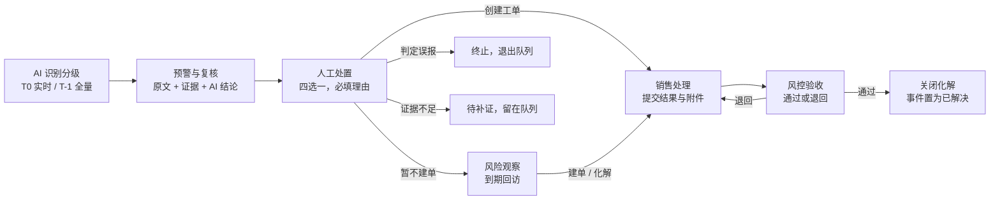
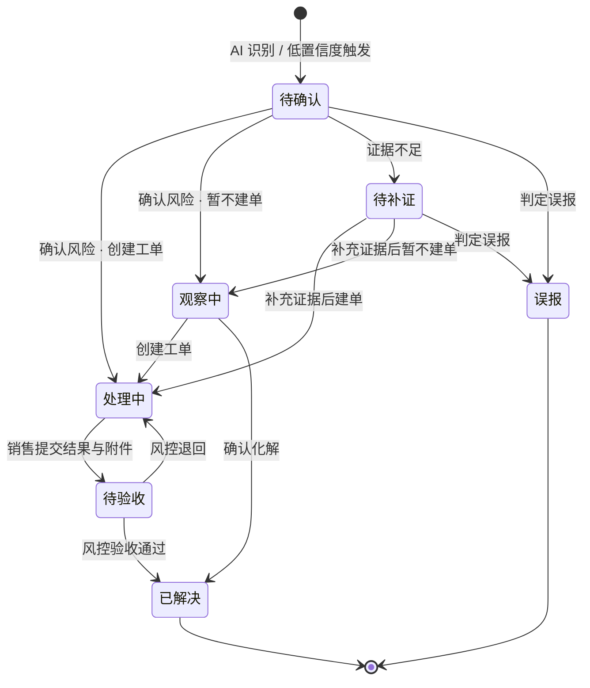
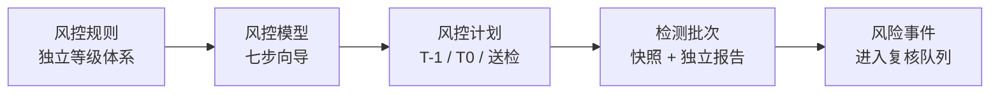

# 合规工作台 · 业务逻辑梳理

> 分析对象：`合规工作台_单文件离线版.html`（3.0b 版本，单文件离线原型）
> 梳理时间：2026-10-29
> 用途：产品评审 / 研发交接 / 后续改造基线

---

## 一、产品定位与角色

**一句话定位**：面向证券投顾场景的企微会话 + 营销素材合规风控工作台。

**核心设计原则**（贯穿全部页面）：

> AI 只给线索和证据，人做判定；销售只做执行，风控做验收。

任何页面都不允许 AI 直接建单、直接处罚、直接关闭风险。

| 角色 | 职责 | 对应页面 |
|---|---|---|
| 风控专员（周敏、李妍、郑阳） | 复核预警、判定等级、建单、验收、素材审核 | 预警与复核、处理工单、素材审核 |
| 风控主管 | 任务转派、团队负载监控、批次复盘 | 团队工作台、风控检测批次、模型质量 |
| 销售（王蕊、刘杉、赵启、何静、孙浩） | 接收工单、联系客户、提交处理结果与附件 | 处理工单（处理中） |
| 配置管理员 | 维护规则、模型、计划、权限、数据接入 | 风控规则 / 风控模型 / 风控计划 / 系统配置 |
| 素材送检人（苏宇、嵇康、林悦） | 提交素材送检 | 素材审核 |

---

## 二、技术架构与数据落地

原型是「React 外壳 + 原生 DOM 业务引擎」的双层结构，理解这一点才能改得动代码。

```
┌─────────────────────────────────────────────┐
│  React + AntD 外壳                           │
│  Layout.Sider（导航）/ Header（面包屑、铃铛、   │
│  数据迁移、用户）/ Content（渲染业务页）        │
├─────────────────────────────────────────────┤
│  dht 桥接组件                                 │
│  把虚拟 DOM 节点映射为 AntD 组件并代理事件      │
├─────────────────────────────────────────────┤
│  KX() 引擎                                    │
│  new Function 在虚拟 document 中执行业务代码   │
│  业务代码 = 6 段模板字符串拼接                  │
└─────────────────────────────────────────────┘
```

**业务代码分段位置**（都在同一个 `<script>` 内）：

| 变量 | 内容 |
|---|---|
| `pNe` | 导航、初始 state、基础渲染器、事件/复核/工单/规则/模型/计划/素材/批次/质量/配置 |
| `hNe` | 风控模型七步配置向导（`MW` 对象、校验、试跑、发布） |
| `gNe` | 客户风险趋势图（T0–T3 × 1.0/2.0/3.0 产品） |
| `mNe` | 新版「预警与复核」三栏工作台（队列 / 会话 / 详情） |
| `vNe` | 批次独立报告（6 个 tab）、团队分析、导出 HTML 报告 |
| `yNe` | 主管视角：转派、复核记录、时限计算 |

**持久化**：

| Key | 内容 | 写入时机 |
|---|---|---|
| `jianwei-v1` | 全量 `state`（事件、工单、素材、规则、模型、计划、批次、审计） | 每次 `save(action)` |
| `jianwei-model-wizard` | 模型向导草稿（`MW` + 当前步骤） | 每次字段变更 / 保存草稿 |

`file://` 直开与 `localhost` 的 localStorage 不互通，所以 Header 提供「数据迁移」（导出 / 导入 JSON）。

---

## 三、数据模型

### 3.1 实体关系

```
风控规则 ──引用──> 风控模型 ──绑定──> 风控计划 ──执行──> 检测批次 ──产出──> 风险事件
                                                                              │
                                                                        1:1  │ 建单
                                                                              ▼
                                                                          处理工单

营销素材 ──送检──> AI 检测 ──审核──> 发布资格（按版本）

风险事件 ──客户编号 cid──> 客户档案（多事件聚合）
```

### 3.2 核心实体字段

**风险事件 `events`**

| 字段 | 说明 |
|---|---|
| `id` | `EV-1025-001` |
| `client` / `cid` | 客户名 / 客户编号（K-2031），历史风险按 `cid` 关联 |
| `sales` / `team` | 责任销售 / 所属团队 |
| `level` | `T0` `T1` `T2` `T3` `—`（`—` = 低置信度未定级） |
| `risk` | 外诉风险 / 内诉风险 / 退款风险 / 抱怨风险 / 低置信度复核 |
| `text` | AI 命中的原文片段 |
| `time` / `source` | 识别时间 / 来源（实时 T0、T-1 批次） |
| `score` / `conf` | 规则评分（越低越严重）/ 置信度 % |
| `status` | 待确认 / 待补证 / 观察中 / 处理中 / 待验收 / 已解决 / 误报 |
| `rule` | 命中的规则名 + 版本 |
| `logs[]` | 处理轨迹（人可读字符串数组） |
| `order` / `amount` | 关联订单 / 金额 |
| `aiLevel` / `aiScore` | 人工修正后保留的 AI 原始结论 |
| `reviewOwner` / `reviewTeam` | 风控责任人 / 复核团队（转派时改） |
| `follow` | 观察中事件的下次跟进时间 |
| `resolvedAt` / `stageEnteredAt` | 化解时间 / 进入当前阶段时间 |

**处理工单 `tickets`**：`id`、`eid`（对应事件）、`status`（处理中/待验收/已解决）、`due`、`requirement`、`result`、`files[]`、`submittedAt/By`、`acceptedAt/By`、`acceptanceDueAt`

**营销素材 `materials`**：`id`、`title`、`type`（图文/视频/海报/音频/文字脚本）、`version`、`submitter`、`score`、`status`（待审核/人工通过/自动通过/退回修改/资格已撤销）、`text`、`risk`、`qualification`（发布资格布尔）、`reason`

**风控规则 `rules`**：`name`、`desc`、`version`、`levels`、`levelItems[]`、`criteria[]`（判定条件）、`scoreRanges[]`、`status`（已发布/草稿）、`standard`（评分标准）、`exclude`（排除条件）、`evidence`（证据要求）、`positive` / `negative`（正反例）、`history[]`

**风控模型 `models`**：`name`、`code`、`scene`、`owner`、`version`、`modalities[]`、`dimensions[]`、`ruleConfig[]`、`rules`（摘要字符串）、`systemPrompt` / `userPrompt`、`schemaText`（JSON Schema）、`testResult`、`releaseNotes`、`status`（草稿/已发布）、`draftKey`、`history[]`

**风控计划 `plans`**：`name`、`type`（T-1 定时 / T0 实时 / 素材送检）、`model`、`range`、`frequency`、`status`、`thresholds[]`（按规则的置信度阈值）、`reviewTeam`、`source`、`insufficient`（证据不足策略）、`t0deadline`、`otherDeadline`、`notification`

**检测批次 `batchReports`**：`id`、`plan`、`type`、`status`、`time` / `end` / `window`、`customers`、`messages`、`score`、`previous`、`distribution[5]`、`tokens[输入, 输出]`、`ids[]`（关联事件）、`failures[]`、`snapshot{}`（模型/规则/阈值/团队/证据策略快照）、`detections[]`、`teamAnalysisSnapshot`

---

## 四、主链路：会话质检



### 4.1 识别阶段

两条并行链路，**不互相替代**：

| 链路 | 频率 | 说明 |
|---|---|---|
| T0 实时监测 | 每 30 秒，上下文窗口 30 分钟 | 命中立即通知风控，10 分钟内必须确认，不等日报 |
| T-1 每日全量 | 每日 02:00，窗口前一天 00:00–24:00 | 全量评分，次日批次仅对实时已识别的事实做关联补充 |

**分级标准**（写在规则编辑器默认值里，代码硬约束）：

| 等级 | 含义 | 评分区间 |
|---|---|---|
| T0 | 外诉风险（明确提出监管/外部投诉） | 0—19 |
| T1 | 内诉风险（明确提出公司内部投诉） | 20—39 |
| T2 | 退款风险（表达退款、退费诉求） | 40—59 |
| T3 | 抱怨风险（未达投诉退款程度） | 60—79 |

**评分方向：分数越低风险越高。** 无风险与证据不足独立输出，不占用 T0–T3。

**置信度阈值**：按规则单独配置（演示值：客户经营风险 85%、销售话术合规 90%）。未命中风险但置信度低于阈值的结果**同样进入复核**，等级标 `—`，走同一套人工处置流程。

### 4.2 复核阶段（三栏工作台）

- **左栏**：预警队列，支持按等级（T0/T1/T2/T3/未定级）和状态筛选，只显示 `待确认 / 待补证 / 处理中`。
- **中栏**：企微原始会话记录，命中片段高亮 `mark`，低置信度显示「待核查原文」，保留消息顺序、时间、MSG 编号。
- **右栏**：三个 tab
  - 复核详情：AI 原始提示 + 人工结论 + 命中规则 + 业务证据链（订单、合同、退款审批、适当性回访）
  - 处理轨迹：`logs[]` 时间线
  - 历史风险：按 `cid` 聚合该客户全部其他风险记录（含已解决、误报），可跳转详情

**人工修正**：可改等级与评分，规则是「保留 AI 原始值（`aiLevel`/`aiScore`），业务采用人工结论」，修正必须填理由，写入 `logs` 和审计。

### 4.3 处置阶段（四选一）

| 动作 | 结果状态 | 前置校验 | 后续 |
|---|---|---|---|
| 确认风险 · 创建工单 | 事件 → 处理中，生成工单 | 已有工单则直接打开，不重复建 | 进入销售处理 |
| 确认风险 · 暂不建单 | 观察中 | 必须填下次跟进时间 | 进入风险观察 |
| 判定误报 | 误报（终态） | 必须填理由 | 退出所有队列 |
| 证据不足 | 待补证 | 必须填理由 | 留在复核队列 |

**事件与工单严格一对一**，一张工单只对应一个风险事件，证据链自动沿用。

### 4.4 工单阶段

```
风控确认 → 销售处理 → 风控验收 → 解决关闭
```

- 销售侧：可追加跟进记录；提交时必须填处理结果说明 **且至少上传一个附件**（演示版只保留文件名）。
- 提交后事件和工单同时置为 `待验收`，事件仍**未解除风险**。
- 风控侧：验收通过（事件置 `已解决`，客户等级重新计算）或退回（必须填理由 + 新截止时间，回到 `处理中`，保留历次提交记录）。

### 4.5 时限规则

| 场景 | 时限 | 计算方式 |
|---|---|---|
| T0 确认 | 10 分钟 | `detectedAt + 10min` |
| 其他风险确认 | 24 小时 | `detectedAt + 24h` |
| 工单验收 | 24 小时 | `submittedAt + 24h` |
| 工单处理 | 人工指定 | 建单时填 `due`，退回时可改 |

---

## 五、状态机



### 5.1 页面归属矩阵

这是排查「事件去哪了」的关键：

| 事件状态 | 预警与复核 | 风险观察 | 处理工单 | 风险事件 |
|---|---|---|---|---|
| 待确认 | ✅ | — | — | ✅ |
| 待补证 | ✅ | — | — | ✅ |
| 观察中 | — | ✅ | — | ✅ |
| 处理中 | ✅ | — | ✅ | ✅ |
| 待验收 | — | — | ✅ | ✅ |
| 已解决 / 误报 | — | — | 已解决在工单页 | ✅ |

### 5.2 状态同步

事件与工单状态在三个动作里**双向强同步**：

- `submitTicket`：`ticket.status = event.status = '待验收'`
- `acceptTicket`：`ticket.status = event.status = '已解决'`
- `saveReturn`：`ticket.status = event.status = '处理中'`

---

## 六、配置链路



### 6.1 风控规则

- **每条规则拥有独立等级体系**，不要求全系统统一 T0–T3（营销素材规则用「高/中/低」）。
- 一条规则由多行「等级 + 判定条件/排除边界 + 评分区间」组成，外加：评分标准、排除条件、证据要求、正例、反例。
- 发布即生成新版本号（`v2.1 → v2.2`），旧版本进 `history`，**不原地覆盖**。
- 规则库只维护判定依据，不在规则里直接改模型。

### 6.2 风控模型（七步向导）

| 步骤 | 内容 | 硬校验 |
|---|---|---|
| 1 基本信息 | 名称、编号、业务场景、负责人、模型服务、模型说明 | 名称 + 编号必填，内容类型至少选一项 |
| 2 质检维度 | 金融合规 40% / 适当性 25% / 风险揭示 20% / 服务质量 15% | 至少启用一个维度，启用维度权重合计 = 100% |
| 3 风险规则 | 从规则库关联已发布规则，按维度分组配权重 | 至少一条启用规则，维度内权重合计 = 100% |
| 4 Prompt 配置 | 系统提示词 + 用户模板（6 个变量占位符） | 两者均必填 |
| 5 JSON 输出 | JSON Schema，固定字段 + 可扩展字段 | Schema 必须合法，字段类型校验 |
| 6 测试调试 | 选内容类型（文字/图片/音频/视频），载入样本试跑 | 权重、规则、Schema 全部通过 |
| 7 发布版本 | 版本号（自动 +1）、版本说明 | 版本说明必填，同编号同版本不可重复发布 |

**输出结构**（固定字段）：

```json
{
  "risk_level": "T0",
  "score": 12,
  "confidence": 0.97,
  "findings": [{ "rule_id", "reason", "message_id", "evidence" }],
  "rule_results": [{ "rule_id", "rule_version", "matched_levels", "highest_level", "score", "confidence", "status", "evidence_refs", "reason" }],
  "evidence_refs": ["MSG-001"],
  "review_required": true,
  "scoring_complete": true
}
```

- 同一条规则多级命中时**保留全部命中并取最高风险**。
- 综合分算法：规则在维度内按权重加权 → 维度再按权重加权 → 任一规则不可评分则综合分为 `null` 并标 `scoring_complete: false`。
- 试跑为**本地关键词匹配**（`12386/监管/外诉` → T0，`负责人/内诉` → T1，`退款/退费` → T2，`抱怨/敷衍` → T3），不调用真实模型，Token 固定显示 0。

### 6.3 风控计划

- 执行方式三选一：`T-1 定时`（每日固定时间 + 数据窗口）/ `T0 实时`（触发间隔秒 + 上下文窗口分钟）/ `素材送检`（收到即执行）。
- **只能绑定「已发布」的模型版本**，草稿不可执行。
- 按规则单独配置信度阈值，低于阈值转人工。
- 其他配置：客户范围、数据源、组织范围、复核团队、分派方式（轮询 + 同客户同规则优先原负责人）、证据不足策略、T0 确认时限、其他风险确认时限、通知渠道。
- 启停不删除历史任务，已有提醒继续执行。

### 6.4 检测批次

- 每个批次生成**独立报告**，检测快照、问题明细、任务进度、Token 消耗按批次隔离。
- 概览包含配置快照：模型版本、规则版本、规则阈值、复核团队、证据策略。
- 6 个 tab：概览 / 团队分析 / 风险问题 / 人工复核 / 处理工单 / 失败与补采。
- **团队分析为演示估算**：团队会话量按 35/30/20/15 占比分摊到批次客户数，风险率 = 本批次风险命中数 ÷ 团队估算会话量 × 1000‰；未定级记录不计风险命中但纳入待复核；零会话量风险率显示「—」。
- 失败项重试**补充原批次**，不重复生成事件或工单。
- 导出为单文件 HTML（内联图表快照）。

### 6.5 版本铁律

> 规则、模型每次发布都是新版本快照；**已有计划不会自动升级**，必须手动在计划里改绑定版本。

---

## 七、素材审核链路

```
素材系统送检 → AI 检测 → 自动通过 / 待人工审核 → 人工通过 / 退回修改 → 发布资格（按版本）
                                                                  └→ 可撤销资格
```

- 检测输入：视频/音频走转写文本，海报/图片走 OCR，图文走原文。
- 审核判定：得分 < 70 视为有风险；风险提示、规则得分、置信度、发布资格四项展示。
- 人工动作：退回修改（素材系统改完重新送检）/ 人工通过（当前版本获得发布资格）/ 撤销发布资格（必须填理由）。
- **发布资格只对当前版本生效**，换版本需重新送检。
- 结果回传素材系统（演示环境仅标记状态，不真实回传）。

---

## 八、横切能力

| 能力 | 实现 |
|---|---|
| 审计日志 | 所有 `save(action)` 自动写 `{time, action}` 到 `state.audit`，系统配置页可查 |
| 权限与数据范围 | 10 项操作权限 × 3 档数据范围（全公司/指定团队/本人），**不强制绑定角色**，可自由组合 |
| 通知配置 | 7 个场景（T0 预警、复核分派、工单指派、风控超时、销售超时、提交验收、退回）× 站内 / 企业微信 |
| 数据迁移 | 导出全量 JSON / 导入 JSON（导入前自动备份当前浏览器数据） |
| 数据接入 | 企微会话存档、通话录音转写、直播间评论、客户与销售归属、订单退款合同、适当性回访、素材系统，共 7 个数据源 |
| 重置演示数据 | 清空本浏览器记录，恢复初始样本 |
| 导出 | 风险明细 CSV、批次独立报告 HTML |

---

## 九、页面清单与入口

| 分组 | 页面 | key | 有导航入口 |
|---|---|---|---|
| 工作空间 | 工作台 | `personal` | ✅（但内容为空壳） |
| 工作空间 | 团队工作台 | `work` | ✅ |
| 风险处理 | 预警与复核 | `alerts` | ✅（含铃铛角标） |
| 风险处理 | 风险事件 | `events` | ✅ |
| 风险处理 | 风险观察 | `observe` | ✅ |
| 风险处理 | 处理工单 | `tickets` | ✅ |
| 质检配置 | 风控规则 | `rules` | ✅ |
| 质检配置 | 风控模型 | `models` | ✅ |
| 质检配置 | 风控计划 | `plans` | ✅ |
| 审核与报表 | 素材审核 | `materials` | ✅ |
| 审核与报表 | 风控检测批次 | `batches` | ✅ |
| 审核与报表 | 模型质量 | `quality` | ✅ |
| 系统管理 | 系统配置 | `settings` | ✅ |
| — | 经营看板 | `dashboard` | ❌ **无入口** |

---

## 十、已知问题清单

按严重程度排序，前三条建议在评审前修掉。

### P0-1 默认落地页是空壳

初始 `page = 'personal'`，而 `views.personal` 只返回标题加一句「个人任务由 React 工作台呈现。」，没有任务列表。打开原型第一眼是空白页。

**建议**：要么把 personal 实现成「我的待办」（待确认 + 处理中 + 待验收三块），要么默认落到 `alerts`。

### P0-2 经营看板不可达

`dashboard` 已实现客户风险趋势（T0–T3 × 1.0/2.0/3.0 产品分层）、当前风险分布、重点风险客户、团队风险分布、素材风险，但 `navGroups` 里没有 `dashboard` 项，全文件也没有任何 `navigate('dashboard')` 调用。

**建议**：在「工作空间」组加一项「经营看板」，或把它作为 personal 页的下半部分。

### P0-3 重置演示数据后批次页崩溃

`state.batchReports` 的初始化（`reportSeeds` 写入）只在脚本加载时执行一次。`resetDemo` 把 `state` 重置为 `initial`（不含 `batchReports`），之后 `batchesView` 直接 `state.batchReports.map(...)` 抛 TypeError，必须刷新页面才能恢复。

**建议**：把批次初始化抽成 `ensureBatchReports()`，在 `render()` 前和 `resetDemo` 后都调用。

### P1-4 建单会覆盖销售归属

`createTicket` 中 `e.sales = $('#assignee').value`，把「处理销售」直接写回事件的责任销售字段。责任销售是成交时锁定的归属，工单处理人是另一回事。这会导致按销售/团队统计全部失真。

**建议**：新增 `ticket.assignee` 字段，事件 `sales` 保持不变。

### P1-5 一半指标是硬编码

以下数据写死在模板字符串里，不读 `state`：看板四个统计卡、团队任务负载表、模型质量四项指标与三条规则明细、批次评分趋势图、评分分布、团队风险分布。

**建议**：能算的从 `state` 算（团队负载、质量确认率可基于 `events` 统计），算不了的明确标注「演示数据」角标。

### P2-6 素材「自动通过」没有实现

只有初始数据里两条 `status: '自动通过'`，代码里没有任何「无风险且置信度达标即自动放行」的判定逻辑，审核页也不会自动产生新结果。

**建议**：在素材检测落库时按 `score >= 90 && conf >= 95` 自动置为自动通过并回传。

### P2-7 状态机有断头

- `待补证` 没有补证入口：补完证据后如何回到决策？目前只能再次走四选一，没有「补证完成」动作和证据补充记录。
- `误报` 是终态但无法撤销。
- `观察中` 的「下次跟进时间」只是字段，没有真正的到期提醒或定时任务。

**建议**：补一个「补证完成」动作（记录补证材料 → 回到待确认）；误报加撤销（限 24 小时内）；观察中加到期红点。

### P2-8 代码是打补丁式的

以下函数被二次赋值覆盖，前一份逻辑成为死代码：`dashboard`、`review`、`batchesView`、`navigate`、`openEvent`、`modelEditor`、`batchDetail`、`transfer`、`planEditor`。

例如旧版 `review`（单栏 + 右侧详情）仍完整保留在 `pNe` 里，实际生效的是 `mNe` 里的三栏版本。后续改需求很容易改到被覆盖的那一份。

**建议**：合并时以最后一次赋值为准，删除死代码，把 patch 模式改成直接定义。

---

## 附录：关键函数索引

| 函数 | 作用 |
|---|---|
| `render()` | 按 `page` 分发视图，刷新导航、面包屑、铃铛角标 |
| `save(action)` | 写 localStorage + 追加审计日志 |
| `review()` / `reviewSelect` / `reviewSetTab` | 复核工作台（`mNe` 覆盖版） |
| `assign()` / `createTicket()` | 建单与指派 |
| `decision()` / `saveDecision()` | 四选一处置 |
| `correct()` / `saveCorrection()` | 人工修正等级与评分 |
| `ticketDetail()` / `submitTicket()` / `acceptTicket()` / `saveReturn()` | 工单全流程 |
| `ruleEditor()` / `saveRule()` | 规则编辑与版本发布 |
| `modelEditor()` / `MWgo()` / `MWrunTest()` / `MWpublish()` | 模型七步向导 |
| `planEditor()` / `savePlan()` / `togglePlan()` | 计划配置 |
| `batchReportView()` / `batchTeamAnalysis()` / `exportBatchReport()` | 批次独立报告 |
| `supervisorAssign()` / `transfer()` | 风控任务转派 |
| `materialAction()` / `saveRevoke()` | 素材审核与撤销资格 |
| `resetDemo()` / `exportData()` | 重置与导出 |

---

*本文档基于对 `合规工作台_单文件离线版.html` 源码的静态分析整理，所有业务规则均可在代码中定位到对应实现。*
